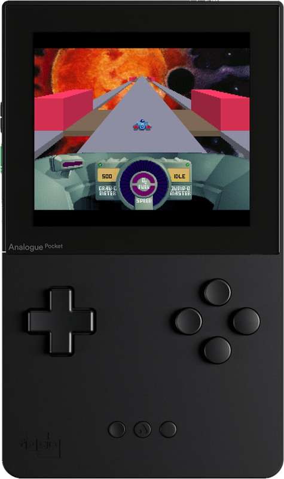
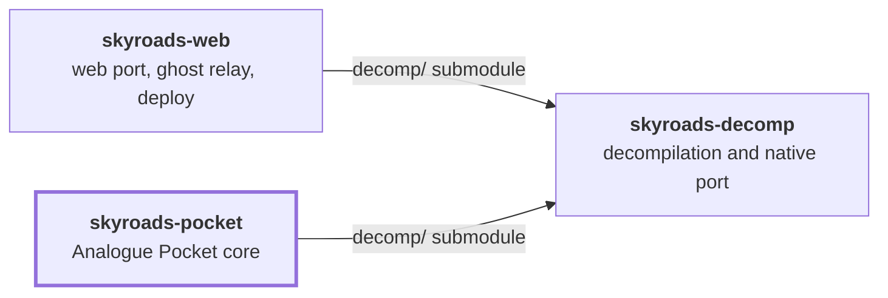

# SkyRoads on the Analogue Pocket

<p align="center">
  
</p>



This repository is **skyroads-pocket**. The others: [skyroads-decomp](https://github.com/bertrandom/skyroads-decomp) · [skyroads-web](https://github.com/bertrandom/skyroads-web).

An openFPGA core that runs the SkyRoads port on the Pocket.  It is not an
emulator, and the game is not rewritten in Verilog: the FPGA holds a small
RISC-V computer (the SoC), and that computer runs the same decompiled C
game code as the native and web ports, compiled for RISC-V.  That code comes
from the decompilation, a git submodule in `decomp/` (`decomp/port`).  The
DOS hardware the game expects is either hardware next to the CPU (the VGA
screen, the AdLib, the Sound Blaster's samples, the PC speaker) or C in the
firmware (the timer and keyboard interrupts, the files).

Only the basic game: no widescreen, no ghosts, no network.

## Installing

Download the zip from the latest of the
[releases](https://github.com/bertrandom/skyroads-pocket/releases) and unzip
it at the root of the Pocket's SD card: it holds `Cores/bertrandom.SkyRoads`,
`Platforms/` and `Assets/skyroads/` (the firmware and the game's files).

```
  Pocket buttons ──► keys register ──► timer interrupt (180 Hz) ──► the game's INT 9 handler / BIOS buffer
                                                                       │
  SDRAM 64 MiB ◄── line arbiter ◄── I-cache 16 KiB ◄── Hazard3 RV32IMAC ──► D-cache 32 KiB ──► SDRAM
       ▲                                              (49.152 MHz)    │
       │                                                              ├──► VRAM 64 KiB (= DOS A000:0000) ──► video 320x200 ──► scaler
  APF bridge loader                                                   ├──► palette
  (firmware, data pack)                                               ├──► OPL queue ──► jtopl2 ─┐
                                                                      ├──► sample queue ─────────┼─► mixer ──► I2S
  APF bridge ◄──► save RAM 1 KiB (skyroads.cfg) ◄─────────────────────┤    PC speaker ───────────┘
                                                                      └──► timer, retrace counter, cycle counter
```

## Status

What has been checked, and how:

| | |
|---|---|
| firmware's platform layer (`firmware/pocket.c`) | native test build (`make host-test`): replays the attract demo to the finish (`demo test: PASS`), and with scripted button presses gets through the intro, the main menu and the world map into Road 1 |
| the Pocket's own LZS decoder (`firmware/lzs_fast.c`) | `make host-check`: every decode of the demo replay (243) is run with both decoders from the same state, and the DOS memory and the files come out identical |
| SoC (`rtl/`) running the firmware | Verilator (`make sim-demo`): Hazard3, the caches, the SDRAM controller against a chip model with timing checks, the loader, the video and the audio. The game boots, plays the intro and credits, and replays the attract demo to the finish (`demo test: PASS`, no SDRAM protocol errors); frames and audio are captured from the video and audio ports |
| speed | the simulated SoC finishes the demo 1.2 s after the native build (83.8 s against ~82 s) with the shared LZS decoder, all of it lost loading at power-on, so the intro and the road run at full speed; with `lzs_fast.c`, 83.1 s |
| the whole core (`fpga/core_top.v` with the template's bridge command handler) | Verilator (`make sim-core`), playing the Pocket's part: the firmware, the data pack and a save written over the bridge as big-endian words, [008F] and [0011]; the CPU starts, the game runs (the intro on the video port) and reads the save; after [0010] the save reads back over the bridge identical and the data slot table says 1 KiB for it. Stand-ins for the Altera PLL, DDIO and RAM primitives, so every clock is the same one here |
| JSON files (`dist/`) | checked against Analogue's openFPGA documentation (data slots, input keys, core.json limits, platform metadata) |
| size | Yosys (`synth_intel_alm`, Cyclone V): about 7,600 LUTs, 1,700 adder cells and 4,700 flip-flops, about 30% of the Pocket's FPGA; about 126 of its 308 M10K block RAMs (60 mapped by Yosys plus the VRAM, the save RAM and the palette, which have a port in another clock domain and which Yosys cannot map) |
| Quartus build and timing | Quartus Prime Lite 18.1 (the `raetro/quartus:pocket` image, below): 4,761 ALMs (26%), 202 of 308 block RAMs, 10 DSP blocks; timing met at every corner, the 49.152 MHz system clock with about 0.1 ns to spare (fitter seed 2); the PLL comes out exactly at 12.288 and 49.152 MHz |
| the real Pocket | played through many of the roads, with the music, the sound effects and the controls; the road completions survive quitting the core and starting it again (checked in the save file on the SD card); sleep and wake carry on the game where it was; the music player (a Core Setting) works |

Two things went wrong on the Pocket that the simulation could not show:

- **SDRAM timing.**  The chip is clocked by the inverted system clock; read
  data is caught at the pad on the falling edge of the system clock (about
  the middle of the window in which the chip drives each word, given the
  chip's tAC and tOH and the pad delays) and then on the rising edge.  The
  first build caught it on the rising edge, which on the Pocket fell between
  two words: a black screen.  The SDRAM pins have no I/O timing constraints.
- **The save's read-back.**  The Pocket sets up the next address before it
  takes the data of a read, so the core answers each read at the next one
  (the save RAM's word is latched on the read strobe).  Answering for the
  address as it stood shifted the save file by a word: its header was lost
  and the progress with it at every restart.  `sim/tb_core.cpp` now reads
  the save back the way the Pocket does.

**The status screen.**  If the firmware has not written the palette 5 s
after power-on (a normal start does it within about a second), the core
shows 64 bits as boxes (green 1, dark red 0), most significant first,
in four rows of 16, so that a core that does not start says why:

| row | boxes |
|---|---|
| 1 | PLL locked, the Pocket released reset, data slots all loaded, loader queue drained, SDRAM initialised, CPU running, firmware set VRAM_BASE, D-cache did a line fill; then 8 red |
| 2 | the I-cache's line fills (16-bit count, wraps) |
| 3, 4 | the byte address of the I-cache's last line fill (26 bits, the last 6 of row 3 and all of row 4) |

All of row 1 green and the screen still up means the firmware runs but
has not reached the game (row 4 then says where it fetches); a red screen
means the firmware runs but the data pack is missing.
- **Timing margin.**  The system clock closes with little slack (Fmax
  49.9 MHz for 49.152); a change to the RTL can lose it.  The SDRAM pins
  have no I/O timing constraints, so Quartus does not check them.
- **The data slot table entry for the save.**  The Pocket writes
  `skyroads.sav` back with as many bytes as the core's data slot table says
  for it.  `core_top.v` writes 1 KiB into the save slot's entry (the third
  slot: word 5) every cycle, as agg23's cores do; the first builds wrote it
  once, after loading, and the progress was not kept (the Pocket writes the
  table too).  `data.json` also has the save slot's bit 5 set (a missing
  save file becomes 1 KiB of 0xFF, which the firmware ignores).

### Getting a bitstream

Quartus Prime Lite is free but runs on Linux and Windows only, and Altera's
downloads now need a (free) Altera account.  On a Mac, the openFPGA
community's usual route is a Docker image with Quartus Lite 18.1
preinstalled (third party, used by many open Pocket cores' CI), run in x86
emulation; from this directory, after `make project` (about 10 minutes):

    docker run --rm --platform linux/amd64 --network none -v "$PWD:/w" -w /w/build/quartus \
        raetro/quartus:pocket quartus_sh --flow compile ap_core

The whole repository is mounted because the project refers to `rtl/` and
`vendor/`.  `mkproject.sh` sets Quartus to one processor: its parallel
helpers crash under the emulation and leave it waiting forever.

## Building

Needs: Homebrew `llvm` (clang with the RISC-V target) and `lld`, Python 3,
Verilator for the simulation, and Quartus Prime Lite (Linux or Windows) for
the bitstream.  The submodule's URL is `../skyroads-decomp`, the
decompilation's repository next to this one; while that is a folder on this
machine rather than a remote, git wants `-c protocol.file.allow=always` on
the submodule commands.

    git submodule update --init   # the decompilation, in decomp/
    ./fetch-deps.sh     # Hazard3, jtopl, Analogue's core template, ymfm into vendor/
    make                # build/skyroads_fw.bin, build/skyroads_data.bin
    make host-test      # the firmware natively: demo replay, PASS/FAIL
    make -C firmware host-check   # the same, checking the fast LZS decoder
    make sim            # Verilator, 4 s: frames in sim/frames
    make sim-demo       # Verilator, the whole attract demo (~30 min)
    make sim-core       # Verilator, the whole core over the APF bridge (~5 min)
    make -C sim sleep   # Verilator, the whole core put to sleep and woken (~2 x 20 min)
    make project        # build/quartus
    # on a machine with Quartus:
    cd build/quartus && quartus_sh --flow compile ap_core
    make package        # build/package: copy it to the SD card's root
    ./push.sh           # or: make package and copy it onto the Pocket over USB
                        # (USB SD card access on; mtools and gum, sudo)

## Layout

| | |
|---|---|
| `firmware/pocket.c` | the platform layer: replaces the port's `main.c`, `platform.c`, `hw.c` and the SDL mixer in `audio.c`; the rest of `decomp/port` (`runtime.c`, `manual.c`, `render.c`, `video.c`, `music.c`, the generated `game.c`) is compiled unchanged, with `SKY_NO_GHOSTS` |
| `firmware/player.c`, `font6x11.h` | the music player (a Core Setting); the font is Pillow's built-in bitmap font (`tools/mkfont.py`) |
| `firmware/savestate.c` | save states, for sleep: the blob in the staging area, saving in the timer interrupt and resuming there |
| `firmware/lzs_fast.c` | the game's LZS decompression with its bit reader in registers: twice as fast to load as the shared decoder on this CPU (which it replaces in the Pocket build only, `SKY_FAST_LZS`) |
| `firmware/host_hal.c` | the SoC's registers simulated on the Mac, for `make host` |
| `firmware/crt0.S`, `link.ld`, `libc/` | start-up, trap entry, the 8 MiB firmware area, the little of the C library the game uses |
| `firmware/pocket_hw.h` | the address map and the registers |
| `rtl/sky_soc.v` | the SoC: CPU, bus decoding, registers, timer |
| `rtl/ahb_cache.v` | direct-mapped cache, zero wait states on a hit; write-back for data |
| `rtl/sdram_ctrl.v`, `rtl/line_arb.v` | 16-byte line bursts with auto precharge; loader / save-state reader / D / I arbitration |
| `rtl/video.v`, `rtl/ahb_dpram.v` | 320x200 scan-out of the VRAM through the palette |
| `rtl/audio.v` | OPL2 write queue and jtopl2, the sample queue, the PC speaker, the mixer |
| `fpga/core_top.v` | the APF glue: clocks, bridge loader, save RAM, save states, run control, I2S |
| `fpga/mkproject.sh` | the Quartus project from the template plus these sources |
| `dist/` | the core's JSON files and platform |
| `sim/` | Verilator testbenches: the SoC (`tb.cpp`), the whole core over the APF bridge (`tb_core.cpp`) and the audio's resampling (`tb_audio.cpp`, `spurs.py`), with an SDRAM chip model (`sdram_model.h`); `profile.py` |
| `tools/mkpack.py` | the game files into one data slot |
| `tools/mkplatimage.py` | the platform image (`Platforms/_images/skyroads.bin`) from the game's main menu |

## How the game meets the hardware

- **Memory.**  The DOS memory (`g_mem`, 1.1 MiB) is in SDRAM.  The VGA
  memory inside it, `g_mem + 0xA0000`, is not: the VRAM is mapped exactly
  there (the `VRAM_BASE` register), so the game draws onto the screen.
- **Time.**  The timer interrupt runs at the rate the game programs the PIT
  (~180 Hz) and does what DOS's INT 8 did (music, speaker effects); a
  retrace counter ticks at 70 Hz, mode 13h's rate, for the game's vsync
  waits.  The display itself runs at 60 Hz.
- **Input.**  The buttons are read in the timer interrupt and become key
  presses: the game's INT 9 handler while it is installed (during a run),
  the BIOS buffer otherwise, with typematic repeat for the d-pad in the
  menus.  A, B and Y (right, bottom, left) are Space in a run and Enter in
  the menus; X (top) and Select are Esc; Start is Enter.  Esc in the main
  menu, which quits to DOS, is ignored (`pocket.c`, a linker wrap of the
  game's key read and `link.ld`'s bounds of the menu's code).
- **Sound.**  The music player (`decomp/port/music.c`) writes OPL2 registers
  into a queue that the hardware feeds to jtopl2 one per chip sample (its
  output, at 49,716 Hz, is interpolated linearly for the 48 kHz I2S side:
  `make -C sim audio` measures a pure tone's spurious energy, -19 dB
  without, -34 dB with); the
  Sound Blaster samples are fed to a queue played at the game's rate.
- **Files.**  The game files come from the data pack in SDRAM; skyroads.cfg
  (settings and road completions) lives in the save RAM, which the Pocket
  keeps as `skyroads.sav`.
- **Sleep.**  The core supports the Pocket's sleep (and Memories) with save
  states.  For [00A0 Savestate: Start] the timer interrupt
  (`firmware/savestate.c`) records where it interrupted the game
  (`ss_setjmp`), copies the VRAM into RAM and the firmware's changing RAM
  (.data to the heap's end, and the stack in use: about 1.6 MB) into the
  SDRAM's staging area (the last 32 MiB), writes the data cache back and
  says done; the Pocket reads the blob from 0x40000000, each word due by its
  next read, which a two-line read-ahead in the SoC serves.  For [00A4
  Savestate: Load] the Pocket has already written the blob to 0x40000000
  (into the staging area, through the loader); the firmware, at start-up
  when waking or in the timer interrupt if the game runs, copies the RAM
  back with no stack (`ss_resume`, crt0.S), returns a second time from
  `ss_setjmp` inside the interrupt that saved, puts back the hardware it
  cannot read (VRAM, palette, OPL2 registers, speaker, volume) and returns
  into the game.  A blob from another firmware build is ignored (a hash of
  the code).  `make -C sim sleep` puts the whole core to sleep and wakes it,
  with the save state loaded before and after the CPU starts.

## Music player

A Core Setting, **Music player** (off by default; `interact.json`, written
by the Pocket to 0x60000000 and read by the firmware as SETTINGS bit 0),
turns the core into a player for the game's 14 songs, to listen to them
apart from the game (`firmware/player.c`).  The game is kept aside while it
runs, with the save-state code (`ss_excursion`: a snapshot at EXC_BASE in
the SDRAM), and comes back as it was when the setting is turned off.

    Up / Down     choose a song          A     play, or play / pause
    Left / Right  10 seconds back / on   B     stop
    L / R         60 seconds back / on

It shows each song's length and where it loops back to (a song is a list
of events up to a jump back to its loop mark; the length is the sum of the
delays before the jump, in 180 Hz timer ticks).  Seeking plays the song
from its start to the place with the OPL2 not told, then tells it every
register as the player left them.  While the player runs the Pocket cannot
sleep (save states are refused).  `sim/tb.cpp --settings` sets the setting
in the simulation.

## Credits and licences

SkyRoads is © 1993 Bluemoon Interactive, who have made it freeware: the
full game is a free download from their site,
<http://www.bluemoon.ee/history/skyroads/index.html>.  The package
includes the game's files (the data pack, `skyroads_data.bin`, built by
`tools/mkpack.py` from `decomp/resources/Skyroads`) and its code, as
decompiled in `decomp/`; the platform image is the game's main menu.

The bitstream contains jtopl (GPL-3.0) and Hazard3 (Apache-2.0); a
distributed bitstream is therefore under the GPL-3.0.  Analogue's template
files come from `vendor/core-template` at build time and are not in this
repository.
